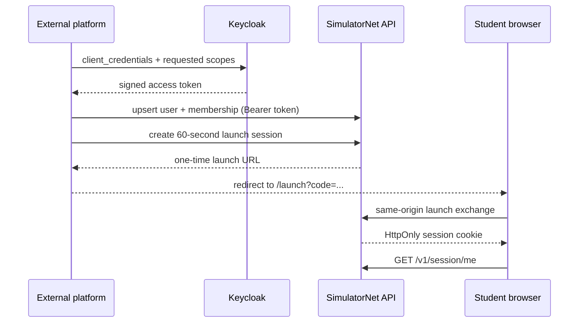

# SimulatorNet

Open-source, browser-based network simulator for CCNA-level labs. Devices,
packets, protocols and CLI run entirely on the student's machine; the server
manages users, labs, assignments, results and integrations — no virtual
machines or vendor images.

This is a **simulator**, not an emulator: switch/router/protocol behaviour is
implemented directly in TypeScript with a Cisco-like (not Cisco) CLI.

## Why a shared core

The same deterministic engine (`@sim/sim-core`) runs in two places:

- in the browser (inside a Web Worker) for interactive labs;
- on the server (headless) to re-verify a submission and compute the grade.

Given identical topology, configuration, seed and input events, both must
produce **exactly** the same result. That is what makes server-side grading
tamper-proof — the browser is never trusted to report its own score.

## Monorepo layout

```
packages/
  contracts/   Shared types + Zod schemas (topology, lab and grading contracts)
  sim-core/    Deterministic simulation engine (no DOM, no Node, no timers)
  cli-engine/  Cisco-like CLI adapter over public sim-core methods
  lab-format/  Versioned validation, canonical JSON, rebuild and serialization
  sim-worker/  Typed worker protocol, runtime owner and browser client
  grading-core/ Pure deterministic checks, scoring, redaction and resource limits
  db/          Node-only PostgreSQL schema, migrations and tenant repositories
  authz/       Framework-independent role and service-scope policies
apps/
  web/         React/Vite browser simulator (React Flow + xterm.js)
  verifier/    Headless Node adapter and JSON fixture CLI
  api/         Minimal internal Fastify validation/verification API
infra/         PostgreSQL 18, Keycloak 26.7.0 and API development Compose stack
```

`sim-core` and `grading-core` remain independent of Fastify, DOM and Node file
APIs. The deterministic engine has no `Date.now()` / `Math.random()` /
`setTimeout` simulation paths.

## Requirements

- Node.js 24 LTS (see `.nvmrc`)
- pnpm (via `corepack enable`)
- Docker with Compose (for PostgreSQL/Keycloak integration workflows)

## Getting started

```bash
pnpm install
pnpm dev         # start the browser simulator at http://127.0.0.1:4173
pnpm build       # production web + worker bundles
pnpm build:server # production verifier + API bundles
pnpm test        # run the full test suite once
pnpm test:watch  # watch mode
pnpm typecheck   # type-check every package
pnpm test:e2e    # run the Chromium browser vertical slice
pnpm dev:api     # start the internal API at http://127.0.0.1:3000
pnpm verify:fixture # run the deterministic verifier JSON fixture
pnpm db:migrate     # apply committed PostgreSQL migrations
pnpm db:seed:dev    # idempotently create the local development tenant
```

## Milestone 1

Deterministic core with an L2 data plane: virtual clock, seeded PRNG,
event queue, Ethernet, MAC learning + flooding, ARP, IPv4, ICMP — proven by an
end-to-end PC↔switch↔PC ping and a determinism golden test.

## Milestone 2

The full CCNA protocol layer in `sim-core`:

- **Router** — routed interfaces and dot1Q subinterfaces, connected + static
  routes resolved by longest-prefix match, per-router ARP, and IPv4/ICMP
  forwarding with TTL decrement plus net-unreachable / time-exceeded replies.
- **VLANs** — the L2 switch gained access/trunk ports, 802.1Q tagging, native
  VLAN and allowed-VLAN lists, with a per-VLAN forwarding database.
- **Router-on-a-stick** — inter-VLAN routing over a single tagged trunk.
- **DHCP** — a server (per-subnet pools) on the router and a DORA client on the
  PC.

Proven by 31 Vitest tests, including a router-on-a-stick determinism golden test.

## Milestone 3

A Cisco-like **CLI engine** (`packages/cli-engine`): a mode-aware console
session (user/privileged EXEC, global/interface/VLAN config) with a lexer,
pattern parser, per-mode command handlers, table formatters and typed errors.
The CLI contains no network logic — handlers only call public `sim-core`
methods (e.g. `switchport access vlan 10` → `switch.setAccessVlan(...)`), so the
same engine still grades headless. Includes golden transcript tests and an
end-to-end check that a router-on-a-stick configured entirely from the CLI
produces a working data plane.

## Milestone 4

The pure TypeScript **versioned lab format** (`packages/lab-format`) connects
contracts to the simulation core. Its public API is:

- `parseLabDocument` / `migrateLabDocument` for schema-versioned validation;
- `canonicalizeLabDocument` / `stringifyLabDocument` for stable JSON;
- `buildLabFromDocument` for a deterministic engine and typed device registry;
- `serializeLabDocument` for a structured snapshot of current configuration.

`LabDocument` stores topology, stable interface definitions, structured PC /
switch / router configuration and the simulation seed. It does **not** store
runtime state such as ARP or MAC tables, DHCP leases, packet queues, counters,
event queue, virtual time or trace. Those are re-derived by the engine after a
rebuild. Browser submissions use a separate `LabSubmissionDocument`; hidden
grading tests/specifications are server-only and never enter the browser lab
document.

## Milestone 5

The browser simulator vertical slice introduced the React Flow topology,
per-device xterm.js CLI, virtual-time controls, event trace and versioned JSON
import/export. The main thread owns only React, editor/UI state and plain JSON;
the module Web Worker remains the sole owner of the simulation engine, device
instances, CLI sessions, event queue, virtual clock and trace.

## Milestone 6

The vertical slice is now a professional, desktop-first network-lab workspace:

- a compact application bar, mode-aware tool rail and searchable device
  library surround a canvas that remains the primary surface;
- the resizable Inspector exposes Overview, Interfaces, Configuration and
  bounded Runtime views from typed worker snapshots;
- the resizable bottom dock contains independent Terminal, Events, Packet
  Trace and Problems views, including persistent tabs for multiple isolated
  CLI sessions;
- device, link and empty-canvas context menus expose only working actions;
- selected devices, link/port labels, topology status, pending edits and worker
  state are explicit and are not communicated by colour alone.

### Edit and Simulate

**Edit** enables device placement, drag/drop, links, deletion, duplication,
renaming and auto-arrange. Changes remain a draft and are marked visibly.
**Apply & Rebuild** serializes the current worker configuration, merges it with
the edited topology through `lab-format`, then performs the existing safe
worker rebuild. Moving back to **Simulate** therefore preserves CLI
configuration while deliberately resetting transient runtime state. Simulate
enables Run, Step, Pause, Reset, CLI commands and packet operations.

### Topology, terminals and keyboard

Click a device or link to inspect it; right-click a device to open its CLI or
Inspector. The terminal dock keeps one deterministic worker session per device
and supports switching, closing, copying and clearing without discarding other
open sessions. Useful shortcuts include `Ctrl/Cmd+O` for Import, `Ctrl/Cmd+S`
for Export, `Ctrl/Cmd+Enter` for Run until idle, `Ctrl/Cmd+K` for the command
palette, `Delete` for the selection, `F` for Fit, `Escape` to clear/close and
`?` for the shortcut reference. Shortcuts are suppressed while typing in
inputs or CLI.

The layout targets desktop lab work at 1440×900 and 1280×720 with no page
scrolling. Below 1000 px, the device library and Inspector become overlay
drawers; this milestone does not attempt a phone-optimised topology editor.

### M6 build notes

The requested official `frontend-skill` was not present in either the curated
Codex skill catalog or the available official experimental path, so no
third-party skill was installed; the redesign follows the milestone design
specification directly. New runtime dependencies are `lucide-react` and
`react-resizable-panels`.

Compared with the M5 production build, the eager application JavaScript fell
from 827.43 kB to 367.30 kB (108.83 kB gzip). Topology (186.83 kB), terminal
(338.63 kB), terminal-fit (1.20 kB) and bottom-dock (10.25 kB) code now loads in
separate chunks. CSS changed from 30.91 kB to 49.20 kB (9.53 kB gzip), and the
worker from 110.26 kB to 112.23 kB.

M1 through M6 are complete. The browser remains an untrusted grading
environment: a future headless server verifier will rebuild submissions and
grade them. No backend, authentication, database or grading evaluator is part
of M6.

## Milestone 6.1

The application now starts in a compact welcome workspace instead of loading a
laboratory implicitly. **New Lab** creates an empty deterministic schema-v1
document in Edit mode, **Import Lab** opens an existing JSON document, and
**Load Demo Lab** explicitly opens the router-on-a-stick fixture. Closing a lab
returns to the welcome state and asks for confirmation before discarding edits.

The engineering workspace supports persistent **System**, **Dark** and
**Light** themes. System follows `prefers-color-scheme`; the selected preference
is stored in `localStorage` and applied immediately through the root
`data-theme` attribute. Both palettes use shared semantic design tokens. The
light palette uses cool grey surfaces rather than pure white, while the dark
palette remains the primary visual reference. React Flow's minimap has been
removed; zoom, fit-to-view, panning and the dotted canvas remain available.

CLI parsing now distinguishes incomplete commands, invalid tokens and domain
validation failures. Incomplete commands include usage, syntax errors place a
caret under the first invalid token, and validation errors retain their direct
message. Mode- and device-aware help is available through `?`, `help`,
`ping ?` and `show ?`. Terminal tabs keep separate command histories, prompts
have consistent spacing, empty Enter produces a fresh prompt, clearing output
preserves the session, and output follows the latest line automatically.

M1 through M6.1 are complete. The browser remains an untrusted grading environment.

## Milestone 7

M7 adds a deterministic server verification boundary without adding storage,
identity or deployment concerns. The browser sends only a
`LabSubmissionDocument` containing topology, structured persistent
configuration and seed. `grading-core` validates it, creates a fresh
`LabDocument`, rebuilds the same `sim-core` engine through `lab-format`, resets
transient state by construction, performs deterministic DHCP/ping actions and
calculates points. Browser-provided scores, traces, ping results, ARP/MAC
caches, DHCP leases, event queues and virtual time are never trusted.

Hidden `GradingSpec` definitions are separate server-side contracts and are not
part of `LabDocument` or imported by the web application. Student results
redact hidden titles, expected values and diagnostics; instructor results add
bounded diagnostics without arbitrary stack traces. Verification IDs and core
results are stable for identical input.

### Supported grading checks

- routed or local `ping` success/failure;
- physical interface administrative state;
- switchport mode and optional access VLAN;
- VLAN existence;
- connected or static route existence;
- deterministic DHCP address membership in an IPv4 subnet.

No grading contract accepts JavaScript, regex, dynamic imports or network
callbacks.

### Resource limits

The central MVP envelope is 64 nodes, 128 links, 512 interfaces, 100 grading
checks, 50,000 processed virtual events, 60 seconds of simulated virtual time,
2,000 retained trace records and a 1,000,000-byte JSON payload. Limits are
checked before build where possible and during every verifier-driven event
step. Exceeding one produces a typed `resource-limit` error.

### Verifier CLI

The Node adapter owns file access and timing; grading business logic stays in
the pure package. Run the checked-in routed/DHCP fixture with:

```bash
pnpm --filter @simulatornet/verifier verify \
  --submission ./fixtures/submission.json \
  --grading ./fixtures/grading.json
```

It writes a structured JSON result to stdout and exits `0` after completed
verification, or writes a structured error to stderr and exits `1` for invalid
input or failed execution.

### Fastify API

`apps/api` uses Fastify 5 with Zod domain contracts, OpenAPI, request IDs,
Pino-backed Fastify logging, strict JSON content types, a body-size cap and
graceful `SIGINT`/`SIGTERM` shutdown. CORS is not registered and therefore is
disabled by default.

- `GET /health`
- `GET /ready`
- `GET /openapi.json`
- `POST /v1/labs/validate` — validate and return a canonical lab document;
- `POST /v1/verifications` — rebuild, run checks and return a server-calculated result.

Start it with `pnpm dev:api`; production bundles are created by
`pnpm build:server` and the API bundle runs with
`pnpm --filter @simulatornet/api start`.

> **Internal API warning:** `/v1/verifications` accepts a grading spec directly
> only for M7 development and integration. It must not be exposed publicly
> before M8 authentication and assignment-owned hidden-spec lookup. M7 has no
> users, organizations, roles, OAuth, persistence, queues or browser API client.

## Milestone 8.1 — PostgreSQL persistence

`@sim/db` is a Node-only persistence package built on PostgreSQL 18,
`node-postgres` and Drizzle. It owns the versioned SQL migrations and repository
boundary for organizations, users and identities, organization memberships,
integration clients, external-user links, one-time launch codes, browser
sessions and audit events. It does not import Fastify, HTTP middleware or the
simulation engine.

All tenant operations require a parsed `TenantContext` and include the
organization predicate in reads and mutations. Cross-tenant operations are
limited to the explicit platform-admin repository and narrow authentication
lookups that establish a tenant from an already verified credential. M8 does
not claim database-enforced RLS: the deployment has not yet introduced
separate restricted DB roles, `FORCE ROW LEVEL SECURITY`, or transaction-local
tenant settings. Application-level tenant predicates are covered against a
real database, including connection-pool reuse and cross-tenant read/update
attempts.

Launch codes and browser session tokens are 32 random bytes encoded as
base64url. Only their SHA-256 hashes are stored; plaintext credentials never
enter PostgreSQL or audit metadata. Code consumption is a single conditional
update, so expired/reused codes fail and concurrent exchanges have exactly one
winner.

Create `.env` from `.env.example`, then run:

```bash
pnpm db:generate       # generate a committed migration after a schema change
pnpm db:check          # validate migration history
pnpm db:migrate        # apply committed migrations (never drizzle push)
pnpm db:seed:dev       # safe, idempotent demo-org development data
pnpm db:test:integration
```

The integration suite uses `packages/db/compose.test.yaml` and
`TEST_DATABASE_URL`. The development seed creates no passwords, client secrets,
tokens or production credentials.

## Milestone 8.2 — Keycloak authentication and launch sessions

M8 completes the server-to-server and browser-launch boundary. The external
platform authenticates directly to the pinned Keycloak 26.7.0 realm with OAuth
2.0 Client Credentials. SimulatorNet receives only the signed access token,
validates it with `jose`, maps the verified `azp` to one local integration
client/organization, intersects token scopes with that client's local
allowlist, and executes every repository call with the resulting tenant.



The API verifies RS256 signature, trusted issuer, `simulatornet-api` audience,
`exp`, `nbf`, JWT/Bearer token type, `azp` and required scope. Remote JWKS are
cached and an unknown signing `kid` triggers safe key refresh. Claims are never
used before cryptographic verification. A valid token still fails when its
client mapping is missing/disabled, its organization is suspended, or the
required scope is absent from either the token or local allowlist.

### Realm, clients and scopes

The imported `simulatornet` realm contains a bearer-only resource client
`simulatornet-api` and a confidential service-account client
`external-platform-dev`. Standard Authorization Code, implicit and Direct Access
Grant/password flows are disabled for the service client. Its secret is read
from `EXTERNAL_PLATFORM_CLIENT_SECRET` during realm import and is never committed,
sent to SimulatorNet, or exposed to the browser. These scopes are optional and
must be requested explicitly:

| Scope | API capability |
| --- | --- |
| `users:read` | Read an integration-owned external user |
| `users:write` | Idempotently upsert an external user |
| `memberships:write` | Assign student/instructor/organization-admin membership |
| `launch:write` | Create a one-time launch URL |
| `labs:validate` | Call the protected M7 lab validator |
| `verifications:write` | Call the internal deterministic verifier |

Obtain a development token directly from Keycloak (keep shell history and
output private):

```bash
curl --fail --silent --show-error \
  -u "external-platform-dev:${EXTERNAL_PLATFORM_CLIENT_SECRET}" \
  -d grant_type=client_credentials \
  --data-urlencode 'scope=users:read users:write memberships:write launch:write' \
  http://127.0.0.1:8080/realms/simulatornet/protocol/openid-connect/token
```

### API routes

`GET /health` and `GET /ready` are public and disclose only a coarse status.
OpenAPI at `GET /openapi.json` is enabled in development and disabled in
production unless `OPENAPI_ENABLED=true` is set deliberately.

| Route | Authentication |
| --- | --- |
| `PUT /v1/integrations/users/:externalUserId` | Bearer + `users:write` |
| `GET /v1/integrations/users/:externalUserId` | Bearer + `users:read` |
| `PUT /v1/integrations/users/:externalUserId/membership` | Bearer + `memberships:write` |
| `POST /v1/launch-sessions` | Bearer + `launch:write` |
| `POST /v1/labs/validate` | Bearer + `labs:validate` |
| `POST /v1/verifications` | Bearer + `verifications:write` |
| `POST /v1/session/launch-exchange` | Public one-time code + allowed Origin |
| `GET /v1/session/me` | Browser session cookie |
| `POST /v1/session/logout` | Browser session cookie + allowed Origin |

Example integration calls:

```bash
curl -X PUT http://127.0.0.1:3000/v1/integrations/users/external-user-123 \
  -H "Authorization: Bearer ${ACCESS_TOKEN}" -H 'Content-Type: application/json' \
  -d '{"email":"student@example.kz","displayName":"Student Name"}'

curl -X PUT http://127.0.0.1:3000/v1/integrations/users/external-user-123/membership \
  -H "Authorization: Bearer ${ACCESS_TOKEN}" -H 'Content-Type: application/json' \
  -d '{"role":"student"}'

curl -X POST http://127.0.0.1:3000/v1/launch-sessions \
  -H "Authorization: Bearer ${ACCESS_TOKEN}" -H 'Content-Type: application/json' \
  -d '{"externalUserId":"external-user-123","returnUrl":"http://127.0.0.1:4173/course/ccna"}'
```

Launch codes live for 60 seconds and are atomically consumed once. The browser
removes `code` from the address bar/history before rendering the organization
workspace. The resulting `simulatornet_session` cookie is opaque, `HttpOnly`,
`SameSite=Lax`, `Path=/`, has an explicit eight-hour maximum age, and is
`Secure` in production. Only token hashes are stored. Logout revokes the
server-side session and clears the cookie. State-changing browser requests
require the exact `WEB_ORIGIN`; permissive CORS and cross-site cookies are not
enabled.

### Role policy

`@sim/authz` owns the matrix rather than embedding role checks in handlers:

| Role | Current/future permissions |
| --- | --- |
| `platform_admin` | All platform and organization actions |
| `organization_admin` | Organization users/settings, integrations, lab use/authoring and verification |
| `instructor` | Organization read, lab use/authoring and verification |
| `student` | Lab use |

Integration endpoints may assign only `student`, `instructor` and
`organization_admin`; they can never assign `platform_admin`. A launch request's
`requestedRole` is informational and never elevates the stored membership.

### Local development and environment

Copy `.env.example` to `.env`, replace every `change-me`, then run from the
repository root:

```bash
docker compose up -d db
docker compose up -d keycloak
docker compose up -d db keycloak api

pnpm infra:up       # build API and start both PostgreSQL services + Keycloak
pnpm smoke:m8       # real Client Credentials → launch → cookie → logout smoke
pnpm infra:down
```

For local API development, the API watcher automatically reads the root
`.env`. Start its dependencies, apply migrations, and then run the watcher:

```bash
docker compose up -d db keycloak
pnpm db:migrate
pnpm db:seed:dev
pnpm dev:api
```

Run `pnpm dev` in a second terminal for the web application.

Important variables are `DATABASE_URL`, the two logical PostgreSQL credential
sets, Keycloak bootstrap credentials, `EXTERNAL_PLATFORM_CLIENT_SECRET`,
`KEYCLOAK_ISSUER`, `KEYCLOAK_JWKS_URL`, `KEYCLOAK_AUDIENCE`, `WEB_ORIGIN`,
`PUBLIC_WEB_URL`, `API_BASE_URL` and `OPENAPI_ENABLED`. Compose uses separate
named volumes for SimulatorNet and Keycloak data. `db:migrate` runs committed
migrations and the idempotent development seed creates the local client
mapping before API startup.

Production must replace all development credentials, use TLS origins, keep
OpenAPI disabled/protected, terminate cookies over HTTPS, and provision
Keycloak clients outside the development realm import. The endpoint accepting
raw `gradingSpec` remains internal. M8 has no standalone browser OIDC login,
cross-site iframe support, Keycloak Admin REST automation, assignments, result
persistence, Redis or queues. Anonymous Local Lab mode remains available and is
visually distinct from an Authenticated Organization Session.

## Milestone 10.1 — extensible device model

M10.1 replaces scattered three-device conditionals with a browser-safe
`DEVICE_PROFILES` registry in `@sim/contracts`. Every profile defines a stable
device type, display name, category, capability set, interface template, icon
key, optional CLI profile and short description. The first expanded palette is:

| Device | Interfaces | Core capabilities | CLI |
| --- | --- | --- | --- |
| PC | `eth0` | Ethernet/IPv4 host, DHCP client | Host |
| Server | `eth0`, `eth1` | Ethernet/IPv4 host, DHCP client, service registry | Host |
| Hub | `Eth0/1`–`Eth0/8` | Ethernet repeater | None |
| Bridge | `Eth0/1`, `Eth0/2` | Two-port MAC-learning bridge | Bridge |
| L2 Switch | `Gi0/1`–`Gi0/8` | VLAN switching and dot1Q trunks | Switch |
| L3 Switch | `Gi0/1`–`Gi0/8` | VLAN switching, SVIs, routed ports, IPv4/static routing | L3 switch |
| Router | `Gi0/0`, `Gi0/1` | IPv4/static routing, subinterfaces, DHCP server | Router |

Profiles are metadata, not protocol implementations. `sim-core` still owns all
runtime behavior and attaches the relevant profile to each `Device`. Capability
checks gate CLI commands, worker inspection and UI actions, so unsupported
operations produce stable typed errors instead of accidental casts.

### New deterministic devices

- `Hub` is a true multiport repeater: it never learns addresses and repeats a
  received frame to every other active port. Each branch carries a bounded
  traversal budget, preventing a physical loop from recursing forever.
- `EthernetBridge` is a dedicated two-port learning bridge with deterministic
  flood/filter/forward behavior and MAC aging driven only by virtual time.
- `Server` reuses the common `EndHost` IPv4/ARP/ICMP/DHCP-client behavior.
  Its service registry is deliberately empty in M10.1; DHCP server and other
  application services are M10.2 work.
- `Layer3Switch` composes the existing L2 switch and router data planes. Access
  and trunk ports keep switching; `no switchport` creates routed physical
  ports; `interface vlan <id>` creates an SVI. An SVI is operational only when
  it is administratively up, its VLAN exists and at least one active switchport
  participates in that VLAN. Inter-VLAN forwarding also requires `ip routing`.

Representative L3 switch configuration:

```text
DSW1(config)# interface Gi0/1
DSW1(config-if)# switchport access vlan 10
DSW1(config)# interface vlan 10
DSW1(config-if)# ip address 192.168.10.1 255.255.255.0
DSW1(config-if)# no shutdown
DSW1(config)# ip routing
```

Hub has no interactive CLI. Bridge exposes interface state, running
configuration and `show mac address-table`. Server uses host commands including
`ping`, `arp -a`, `ipconfig` and `ipconfig /renew`. L3 Switch combines switch and
router show/config commands, including `show vlan brief`, `show mac
address-table`, `show ip interface brief` and `show ip route`.

### Documents, worker, grading and demos

Schema-v1 `LabDocument` remains backward compatible while adding structured
Hub, Bridge, Server and L3 Switch configurations. Serialization persists only
configuration: FDB/ARP entries, counters, DHCP leases, trace, event queues and
virtual time are rebuilt. Worker snapshots and capability-aware inspections
remain bounded plain JSON.

Grading adds typed `device-type`, `capability-present`, `svi-state` and
`ip-routing-enabled` checks. Existing interface, switchport, VLAN, route, DHCP
and ping checks also understand applicable new devices. Browser submissions
still contain no hidden grading definitions and no browser-supplied score is
trusted.

The welcome demo selector now includes Router-on-a-stick + DHCP, Hub Ethernet
Basics, Bridge MAC Learning, L3 Switch Inter-VLAN Routing and Server
Connectivity. The device library and topology use neutral distinct icons; the
Inspector conditionally exposes MAC, ARP, route, SVI, repeater-counter and
service-placeholder sections from the selected device's capabilities.

Known M10.1 limits at that checkpoint were no STP/RSTP, link aggregation, port
security, CDP/LLDP, bridge VLANs, dynamic routing, NAT, ACLs or IPv6. A Server
supports one active simulated L3 interface.

## Milestone 10.2 — deterministic transport and server applications

M10.2 adds one reusable transport path shared by PC and Server:

```text
application → per-device UDP/TCP socket → IPv4 → EthernetInterface.transmit
            → deterministic links/routers → IPv4 → socket → application
```

The UDP registry provides exclusive `bindUdp`/`unbindUdp` listeners, stable
ephemeral ports, unicast ICMP port-unreachable behavior, broadcast suppression,
bounded structured payloads and local socket inspection. DHCP client traffic
now uses that registry. The simplified message-oriented TCP model provides
LISTEN and active open, SYN/SYN-ACK/ACK, ordered application messages,
graceful FIN close, RST for closed ports, virtual-time retransmissions and
TIME_WAIT. Connections are keyed by local/remote address and port. It does not
model congestion control, byte windows, SACK, options, fragmentation or real
bandwidth.

Both stacks are pure TypeScript. They use the engine's stable event queue,
integer nanosecond clock and seeded RNG; they do not use browser/Node sockets,
wall-clock timers, `fetch`, `Date.now()` or `Math.random()`.

### Server services

Server owns a lifecycle-aware registry (`disabled`, `starting`, `listening`,
`error`) with persistent discriminated-union configuration and transient
runtime state:

| Service | Transport | Implemented behavior |
| --- | --- | --- |
| DNS | UDP/53 | A records, canonical case-insensitive names, NOERROR, NXDOMAIN and FORMERR |
| HTTP | TCP/80 | one GET/HEAD request, Host/path validation, 200/404/400, content type/body, graceful close |
| TFTP | UDP/69 | read-only RRQ/DATA/ACK/ERROR, 512-character blocks, bounded retry/timeout and not-found |
| NTP | UDP/123 | response derived only from engine virtual time plus configured server offset |
| Syslog | UDP/514 | structured facility/severity/source/virtual timestamp/message and bounded retention |

DNS recursion, CNAME/MX/AAAA/DNSSEC/TCP fallback/cache, TLS, chunked HTTP,
cookies/authentication, TFTP writes/options/filesystem access and real external
network access remain out of scope. Downloaded TFTP files, DNS/HTTP/NTP results,
TCP connections, transfer state and Syslog entries are runtime-only and are
excluded from `LabDocument` serialization.

Central service limits are 16 services per Server, 256 DNS records, 128 HTTP
resources, 65,536 bytes per HTTP body, 64 TFTP files, 262,144 bytes per TFTP
file, 64 downloaded runtime files, 1,000 Syslog entries and 64 concurrent
application requests. Transport limits are 64 UDP sockets, 32 TCP listeners,
128 TCP connections, three retransmissions, 65,536-byte application payloads,
64 queued TCP messages and two seconds of virtual TIME_WAIT.

### CLI, worker and UI

PC and Server host CLIs add:

```text
nslookup <hostname> [dns-server]
sim http get <http://server-ip[:port]/path>
sim tftp get <server-ip> <filename>
sim ntp query <server-ip>
sim show clock
sim syslog send <server-ip> <severity> <message>
sim show udp sockets
sim show tcp connections
```

Server also exposes read-only `sim show services`, `sim show dns`, `sim show
http`, `sim show tftp` and `sim show syslog`. The existing incomplete-command, validation and
contextual `?` help rules apply. Commands drain only deterministic virtual
events through the worker-owned engine.

The Inspector contains compact DNS/HTTP/TFTP/NTP/Syslog editors and sends only
typed `GET_SERVER_SERVICES`, `CONFIGURE_SERVER_SERVICE`, enable/disable,
runtime and clear-Syslog requests. It separately shows UDP sockets, TCP
connections, resolver results, downloaded files, clock state and service
runtime. Server topology nodes carry compact listening-service badges. Packet
Trace can filter UDP, TCP, DNS, HTTP, TFTP, NTP and Syslog events and displays
virtual time, endpoints, ports, event and bounded result summaries.

Focused demos are DNS + Web Services, TFTP Configuration Backup and NTP +
Syslog Operations. They remain explicit choices on the welcome screen and are
never auto-loaded.

### Deterministic grading

Server verification adds `dns-record`, `dns-resolution`, `http-response`,
`tftp-file`, `ntp-response`, `syslog-received` and `tcp-listener` checks. Each
verification rebuilds the submitted persistent document, starts services on
virtual time and performs fresh server-owned actions. Browser results,
downloads, logs, socket tables and traces are never trusted. Hidden checks use
the existing student redaction; instructor results receive bounded diagnostics.

Known M10.2 limits: no real sockets or web fetches, no full RFC TCP semantics,
no Router/L3-switch application hosting, no server-side filesystem, no service
persistence beyond structured lab configuration, and no new routing or
security protocols.

## Milestone 10.2.1 — Packet Tracer-style workspace

The browser now presents the simulator as a compact desktop learning tool. A
seven-item application menu (`File`, `Edit`, `View`, `Lab`, `Simulation`,
`Tools`, `Help`) sits above a separate action toolbar. The logical topology
keeps the largest share of the window, while the two-level bottom palette
groups Network Devices, End Devices and Connections. Devices support both
drag-and-drop and click-then-place. Edit Topology remains distinct from the
Realtime and Simulation execution modes.

Double-clicking a device opens a profile-specific configuration window:
Router and managed switching profiles expose Overview, Config, CLI,
Interfaces and Attributes; PC exposes Desktop utilities and a Command Prompt;
Server adds Services. These are views and controls over the canonical worker
state, not independent configuration copies. The Inspector starts closed at
the 1280 px desktop breakpoint and remains available from View or device
selection.

Theme selection is intentionally available only through **View → Theme**.
Bottom-dock overflow is clipped at the panel boundary; tables own their inner
scrolling and xterm owns terminal scrolling.

The topology canvas is rendered with the MIT-licensed [AntV X6](https://x6.antv.antgroup.com/)
graph engine. It carries no third-party attribution or watermark, so there is
no attribution flag or CSS override to configure.

### Device-aware CLI profiles

M10.2.1 separates PC, Server, Bridge, L2 Switch, L3 Switch and Router command
profiles. PC opens with `C:\>` and Windows-like `ipconfig`, `ping`, `tracert`,
`arp -a`, `nslookup` and `netstat`; Server keeps a named host prompt. Router and
managed switches keep IOS-like modes. Hub deliberately has no CLI.

Keywords accept only unique, case-insensitive prefixes. Common learning forms
such as `conf t`, `show run`, `show ip int br`, `int gi0/1`, `shut` and
`no shut` work; ambiguous input is reported without guessing, and misspellings
are not fuzzy-matched. Help remains device-, mode- and prefix-aware. Router and
L3 Switch bare `ping` prompt for a target; PC bare `ping` reports the required
argument.

Simulator-specific service helpers live under the explicit `sim` namespace and
are labeled as non-IOS extensions. The full support matrix and deliberate
omissions are documented in [docs/cli-compatibility.md](docs/cli-compatibility.md).
