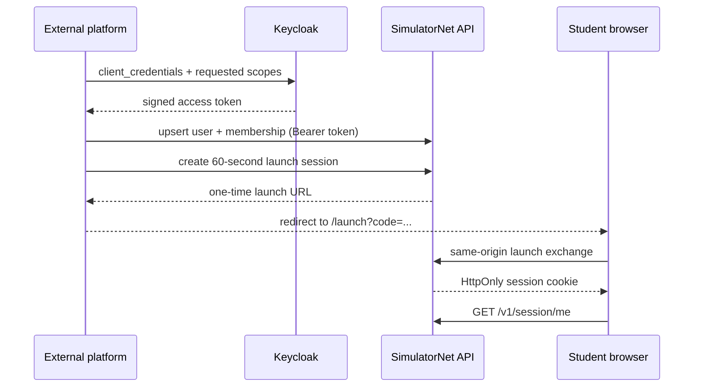

# SimulatorNet

Open-source, browser-based network simulator for CCNA-level labs. Devices,
packets, protocols and CLI run entirely on the student's machine; the server
manages users, labs, assignments, results and integrations — no virtual
machines or vendor images.

This is a **simulator**, not an emulator: switch/router/protocol behaviour is
implemented directly in TypeScript with a Cisco-like (not Cisco) CLI.

## Why a shared core

The same deterministic engine (`@sim/sim-core`) runs in two places:

- in the browser (inside a Web Worker) for interactive labs;
- on the server (headless) to re-verify a submission and compute the grade.

Given identical topology, configuration, seed and input events, both must
produce **exactly** the same result. That is what makes server-side grading
tamper-proof — the browser is never trusted to report its own score.

## Monorepo layout

```
packages/
  contracts/   Shared types + Zod schemas (topology, lab and grading contracts)
  sim-core/    Deterministic simulation engine (no DOM, no Node, no timers)
  cli-engine/  Cisco-like CLI adapter over public sim-core methods
  lab-format/  Versioned validation, canonical JSON, rebuild and serialization
  sim-worker/  Typed worker protocol, runtime owner and browser client
  grading-core/ Pure deterministic checks, scoring, redaction and resource limits
  db/          Node-only PostgreSQL schema, migrations and tenant repositories
  authz/       Framework-independent role and service-scope policies
apps/
  web/         React/Vite browser simulator (AntV X6 + xterm.js)
  verifier/    Headless Node adapter and JSON fixture CLI
  api/         Minimal internal Fastify validation/verification API
infra/         PostgreSQL 18, Keycloak 26.7.0 and API development Compose stack
```

`sim-core` and `grading-core` remain independent of Fastify, DOM and Node file
APIs. The deterministic engine has no `Date.now()` / `Math.random()` /
`setTimeout` simulation paths.

## Requirements

- Node.js 24 LTS (see `.nvmrc`)
- pnpm (via `corepack enable`)
- Docker with Compose (for PostgreSQL/Keycloak integration workflows)

## Getting started

```bash
pnpm install
pnpm dev         # start the browser simulator at http://127.0.0.1:4173
pnpm build       # production web + worker bundles
pnpm build:server # production verifier + API bundles
pnpm test        # run the full test suite once
pnpm test:watch  # watch mode
pnpm typecheck   # type-check every package
pnpm test:e2e    # run the Chromium browser vertical slice
pnpm dev:api     # start the internal API at http://127.0.0.1:3000
pnpm verify:fixture # run the deterministic verifier JSON fixture
pnpm db:migrate     # apply committed PostgreSQL migrations
pnpm db:seed:dev    # idempotently create the local development tenant
```

## Milestone 1

Deterministic core with an L2 data plane: virtual clock, seeded PRNG,
event queue, Ethernet, MAC learning + flooding, ARP, IPv4, ICMP — proven by an
end-to-end PC↔switch↔PC ping and a determinism golden test.

## Milestone 2

The full CCNA protocol layer in `sim-core`:

- **Router** — routed interfaces and dot1Q subinterfaces, connected + static
  routes resolved by longest-prefix match, per-router ARP, and IPv4/ICMP
  forwarding with TTL decrement plus net-unreachable / time-exceeded replies.
- **VLANs** — the L2 switch gained access/trunk ports, 802.1Q tagging, native
  VLAN and allowed-VLAN lists, with a per-VLAN forwarding database.
- **Router-on-a-stick** — inter-VLAN routing over a single tagged trunk.
- **DHCP** — a server (per-subnet pools) on the router and a DORA client on the
  PC.

Proven by 31 Vitest tests, including a router-on-a-stick determinism golden test.

## Milestone 3

A Cisco-like **CLI engine** (`packages/cli-engine`): a mode-aware console
session (user/privileged EXEC, global/interface/VLAN config) with a lexer,
pattern parser, per-mode command handlers, table formatters and typed errors.
The CLI contains no network logic — handlers only call public `sim-core`
methods (e.g. `switchport access vlan 10` → `switch.setAccessVlan(...)`), so the
same engine still grades headless. Includes golden transcript tests and an
end-to-end check that a router-on-a-stick configured entirely from the CLI
produces a working data plane.

## Milestone 4

The pure TypeScript **versioned lab format** (`packages/lab-format`) connects
contracts to the simulation core. Its public API is:

- `parseLabDocument` / `migrateLabDocument` for schema-versioned validation;
- `canonicalizeLabDocument` / `stringifyLabDocument` for stable JSON;
- `buildLabFromDocument` for a deterministic engine and typed device registry;
- `serializeLabDocument` for a structured snapshot of current configuration.

`LabDocument` stores topology, stable interface definitions, structured PC /
switch / router configuration and the simulation seed. It does **not** store
runtime state such as ARP or MAC tables, DHCP leases, packet queues, counters,
event queue, virtual time or trace. Those are re-derived by the engine after a
rebuild. Browser submissions use a separate `LabSubmissionDocument`; hidden
grading tests/specifications are server-only and never enter the browser lab
document.

## Milestone 5

The browser simulator vertical slice introduced the React Flow topology,
per-device xterm.js CLI, virtual-time controls, event trace and versioned JSON
import/export. The main thread owns only React, editor/UI state and plain JSON;
the module Web Worker remains the sole owner of the simulation engine, device
instances, CLI sessions, event queue, virtual clock and trace.

## Milestone 6

The vertical slice is now a professional, desktop-first network-lab workspace:

- a compact application bar, mode-aware tool rail and searchable device
  library surround a canvas that remains the primary surface;
- the resizable Inspector exposes Overview, Interfaces, Configuration and
  bounded Runtime views from typed worker snapshots;
- the resizable bottom dock contains independent Terminal, Events, Packet
  Trace and Problems views, including persistent tabs for multiple isolated
  CLI sessions;
- device, link and empty-canvas context menus expose only working actions;
- selected devices, link/port labels, topology status, pending edits and worker
  state are explicit and are not communicated by colour alone.

### Edit and Simulate

**Edit** enables structural changes: device placement, links, deletion and
duplication. Structural drafts show **Pending topology changes**.
**Apply Topology** serializes current worker configuration, merges it with the
draft through `lab-format`, and rebuilds the worker; **Start Lab** performs that
build automatically when necessary. Presentation changes (positions, labels,
notes and diagram images) are still marked **Unsaved**, but never request a
rebuild and remain editable while the lab runs. Typed configuration changes
also update the worker without rebuilding physical connectivity. Stopping
preserves structured configuration while deliberately clearing transient
runtime state. Packet execution is controlled separately through Auto or Step.

### Topology, terminals and keyboard

Click a device or link to inspect it; right-click a device to open its CLI or
Inspector. The terminal dock keeps one deterministic worker session per device
and supports switching, closing, copying and clearing without discarding other
open sessions. Useful shortcuts include `Ctrl/Cmd+O` for Import, `Ctrl/Cmd+S`
for Export, `Ctrl/Cmd+Enter` for Run All, `Ctrl/Cmd+K` for the command
palette, `Delete` for the selection, `F` for Fit, `Escape` to clear/close and
`?` for the shortcut reference. Shortcuts are suppressed while typing in
inputs or CLI.

The layout targets desktop lab work at 1440×900 and 1280×720 with no page
scrolling. Below 1000 px, the device library and Inspector become overlay
drawers; this milestone does not attempt a phone-optimised topology editor.

### M6 build notes

The requested official `frontend-skill` was not present in either the curated
Codex skill catalog or the available official experimental path, so no
third-party skill was installed; the redesign follows the milestone design
specification directly. New runtime dependencies are `lucide-react` and
`react-resizable-panels`.

Compared with the M5 production build, the eager application JavaScript fell
from 827.43 kB to 367.30 kB (108.83 kB gzip). Topology (186.83 kB), terminal
(338.63 kB), terminal-fit (1.20 kB) and bottom-dock (10.25 kB) code now loads in
separate chunks. CSS changed from 30.91 kB to 49.20 kB (9.53 kB gzip), and the
worker from 110.26 kB to 112.23 kB.

M1 through M6 are complete. The browser remains an untrusted grading
environment: a future headless server verifier will rebuild submissions and
grade them. No backend, authentication, database or grading evaluator is part
of M6.

## Milestone 6.1

The application now starts in a compact welcome workspace instead of loading a
laboratory implicitly. **New Lab** creates an empty deterministic schema-v1
document in Edit mode, **Import Lab** opens an existing JSON document, and
**Load Demo Lab** explicitly opens the router-on-a-stick fixture. Closing a lab
returns to the welcome state and asks for confirmation before discarding edits.

The engineering workspace supports persistent **System**, **Dark** and
**Light** themes. System follows `prefers-color-scheme`; the selected preference
is stored in `localStorage` and applied immediately through the root
`data-theme` attribute. Both palettes use shared semantic design tokens. The
light palette uses cool grey surfaces rather than pure white, while the dark
palette remains the primary visual reference. React Flow's minimap has been
removed; zoom, fit-to-view, panning and the dotted canvas remain available.

CLI parsing now distinguishes incomplete commands, invalid tokens and domain
validation failures. Incomplete commands include usage, syntax errors place a
caret under the first invalid token, and validation errors retain their direct
message. Mode- and device-aware help is available through `?`, `help`,
`ping ?` and `show ?`. Terminal tabs keep separate command histories, prompts
have consistent spacing, empty Enter produces a fresh prompt, clearing output
preserves the session, and output follows the latest line automatically.

M1 through M6.1 are complete. The browser remains an untrusted grading environment.

## Milestone 7

M7 adds a deterministic server verification boundary without adding storage,
identity or deployment concerns. The browser sends only a
`LabSubmissionDocument` containing topology, structured persistent
configuration and seed. `grading-core` validates it, creates a fresh
`LabDocument`, rebuilds the same `sim-core` engine through `lab-format`, resets
transient state by construction, performs deterministic DHCP/ping actions and
calculates points. Browser-provided scores, traces, ping results, ARP/MAC
caches, DHCP leases, event queues and virtual time are never trusted.

Hidden `GradingSpec` definitions are separate server-side contracts and are not
part of `LabDocument` or imported by the web application. Student results
redact hidden titles, expected values and diagnostics; instructor results add
bounded diagnostics without arbitrary stack traces. Verification IDs and core
results are stable for identical input.

### Supported grading checks

- routed or local `ping` success/failure;
- physical interface administrative state;
- switchport mode and optional access VLAN;
- VLAN existence;
- connected or static route existence;
- deterministic DHCP address membership in an IPv4 subnet.

No grading contract accepts JavaScript, regex, dynamic imports or network
callbacks.

### Resource limits

The central MVP envelope is 64 nodes, 128 links, 512 interfaces, 100 grading
checks, 50,000 processed virtual events, 60 seconds of simulated virtual time,
2,000 retained trace records and a 1,000,000-byte JSON payload. Limits are
checked before build where possible and during every verifier-driven event
step. Exceeding one produces a typed `resource-limit` error.

### Verifier CLI

The Node adapter owns file access and timing; grading business logic stays in
the pure package. Run the checked-in routed/DHCP fixture with:

```bash
pnpm --filter @simulatornet/verifier verify \
  --submission ./fixtures/submission.json \
  --grading ./fixtures/grading.json
```

It writes a structured JSON result to stdout and exits `0` after completed
verification, or writes a structured error to stderr and exits `1` for invalid
input or failed execution.

### Fastify API

`apps/api` uses Fastify 5 with Zod domain contracts, OpenAPI, request IDs,
Pino-backed Fastify logging, strict JSON content types, a body-size cap and
graceful `SIGINT`/`SIGTERM` shutdown. CORS is not registered and therefore is
disabled by default.

- `GET /health`
- `GET /ready`
- `GET /openapi.json`
- `POST /v1/labs/validate` — validate and return a canonical lab document;
- `POST /v1/verifications` — rebuild, run checks and return a server-calculated result.

Start it with `pnpm dev:api`; production bundles are created by
`pnpm build:server` and the API bundle runs with
`pnpm --filter @simulatornet/api start`.

> **Internal API warning:** `/v1/verifications` accepts a grading spec directly
> only for M7 development and integration. It must not be exposed publicly
> before M8 authentication and assignment-owned hidden-spec lookup. M7 has no
> users, organizations, roles, OAuth, persistence, queues or browser API client.

## Milestone 8.1 — PostgreSQL persistence

`@sim/db` is a Node-only persistence package built on PostgreSQL 18,
`node-postgres` and Drizzle. It owns the versioned SQL migrations and repository
boundary for organizations, users and identities, organization memberships,
integration clients, external-user links, one-time launch codes, browser
sessions and audit events. It does not import Fastify, HTTP middleware or the
simulation engine.

All tenant operations require a parsed `TenantContext` and include the
organization predicate in reads and mutations. Cross-tenant operations are
limited to the explicit platform-admin repository and narrow authentication
lookups that establish a tenant from an already verified credential. M8 does
not claim database-enforced RLS: the deployment has not yet introduced
separate restricted DB roles, `FORCE ROW LEVEL SECURITY`, or transaction-local
tenant settings. Application-level tenant predicates are covered against a
real database, including connection-pool reuse and cross-tenant read/update
attempts.

Launch codes and browser session tokens are 32 random bytes encoded as
base64url. Only their SHA-256 hashes are stored; plaintext credentials never
enter PostgreSQL or audit metadata. Code consumption is a single conditional
update, so expired/reused codes fail and concurrent exchanges have exactly one
winner.

Create `.env` from `.env.example`, then run:

```bash
pnpm db:generate       # generate a committed migration after a schema change
pnpm db:check          # validate migration history
pnpm db:migrate        # apply committed migrations (never drizzle push)
pnpm db:seed:dev       # safe, idempotent demo-org development data
pnpm db:test:integration
```

The integration suite uses `packages/db/compose.test.yaml` and
`TEST_DATABASE_URL`. The development seed creates no passwords, client secrets,
tokens or production credentials.

## Milestone 8.2 — Keycloak authentication and launch sessions

M8 completes the server-to-server and browser-launch boundary. The external
platform authenticates directly to the pinned Keycloak 26.7.0 realm with OAuth
2.0 Client Credentials. SimulatorNet receives only the signed access token,
validates it with `jose`, maps the verified `azp` to one local integration
client/organization, intersects token scopes with that client's local
allowlist, and executes every repository call with the resulting tenant.



The API verifies RS256 signature, trusted issuer, `simulatornet-api` audience,
`exp`, `nbf`, JWT/Bearer token type, `azp` and required scope. Remote JWKS are
cached and an unknown signing `kid` triggers safe key refresh. Claims are never
used before cryptographic verification. A valid token still fails when its
client mapping is missing/disabled, its organization is suspended, or the
required scope is absent from either the token or local allowlist.

### Realm, clients and scopes

The imported `simulatornet` realm contains a bearer-only resource client
`simulatornet-api` and a confidential service-account client
`external-platform-dev`. Standard Authorization Code, implicit and Direct Access
Grant/password flows are disabled for the service client. Its secret is read
from `EXTERNAL_PLATFORM_CLIENT_SECRET` during realm import and is never committed,
sent to SimulatorNet, or exposed to the browser. These scopes are optional and
must be requested explicitly:

| Scope | API capability |
| --- | --- |
| `users:read` | Read an integration-owned external user |
| `users:write` | Idempotently upsert an external user |
| `memberships:write` | Assign student/instructor/organization-admin membership |
| `launch:write` | Create a one-time launch URL |
| `labs:validate` | Call the protected M7 lab validator |
| `verifications:write` | Call the internal deterministic verifier |

Obtain a development token directly from Keycloak (keep shell history and
output private):

```bash
curl --fail --silent --show-error \
  -u "external-platform-dev:${EXTERNAL_PLATFORM_CLIENT_SECRET}" \
  -d grant_type=client_credentials \
  --data-urlencode 'scope=users:read users:write memberships:write launch:write' \
  http://127.0.0.1:8080/realms/simulatornet/protocol/openid-connect/token
```

### API routes

`GET /health` and `GET /ready` are public and disclose only a coarse status.
OpenAPI at `GET /openapi.json` is enabled in development and disabled in
production unless `OPENAPI_ENABLED=true` is set deliberately.

| Route | Authentication |
| --- | --- |
| `PUT /v1/integrations/users/:externalUserId` | Bearer + `users:write` |
| `GET /v1/integrations/users/:externalUserId` | Bearer + `users:read` |
| `PUT /v1/integrations/users/:externalUserId/membership` | Bearer + `memberships:write` |
| `POST /v1/launch-sessions` | Bearer + `launch:write` |
| `POST /v1/labs/validate` | Bearer + `labs:validate` |
| `POST /v1/verifications` | Bearer + `verifications:write` |
| `POST /v1/session/launch-exchange` | Public one-time code + allowed Origin |
| `GET /v1/session/me` | Browser session cookie |
| `POST /v1/session/logout` | Browser session cookie + allowed Origin |

Example integration calls:

```bash
curl -X PUT http://127.0.0.1:3000/v1/integrations/users/external-user-123 \
  -H "Authorization: Bearer ${ACCESS_TOKEN}" -H 'Content-Type: application/json' \
  -d '{"email":"student@example.kz","displayName":"Student Name"}'

curl -X PUT http://127.0.0.1:3000/v1/integrations/users/external-user-123/membership \
  -H "Authorization: Bearer ${ACCESS_TOKEN}" -H 'Content-Type: application/json' \
  -d '{"role":"student"}'

curl -X POST http://127.0.0.1:3000/v1/launch-sessions \
  -H "Authorization: Bearer ${ACCESS_TOKEN}" -H 'Content-Type: application/json' \
  -d '{"externalUserId":"external-user-123","returnUrl":"http://127.0.0.1:4173/course/ccna"}'
```

Launch codes live for 60 seconds and are atomically consumed once. The browser
removes `code` from the address bar/history before rendering the organization
workspace. The resulting `simulatornet_session` cookie is opaque, `HttpOnly`,
`SameSite=Lax`, `Path=/`, has an explicit eight-hour maximum age, and is
`Secure` in production. Only token hashes are stored. Logout revokes the
server-side session and clears the cookie. State-changing browser requests
require the exact `WEB_ORIGIN`; permissive CORS and cross-site cookies are not
enabled.

### Role policy

`@sim/authz` owns the matrix rather than embedding role checks in handlers:

| Role | Current/future permissions |
| --- | --- |
| `platform_admin` | All platform and organization actions |
| `organization_admin` | Organization users/settings, integrations, lab use/authoring and verification |
| `instructor` | Organization read, lab use/authoring and verification |
| `student` | Lab use |

Integration endpoints may assign only `student`, `instructor` and
`organization_admin`; they can never assign `platform_admin`. A launch request's
`requestedRole` is informational and never elevates the stored membership.

### Local development and environment

Copy `.env.example` to `.env`, replace every `change-me`, then run from the
repository root:

```bash
docker compose up -d db
docker compose up -d keycloak
docker compose up -d db keycloak api

pnpm infra:up       # build API and start both PostgreSQL services + Keycloak
pnpm smoke:m8       # real Client Credentials → launch → cookie → logout smoke
pnpm infra:down
```

For local API development, the API watcher automatically reads the root
`.env`. Start its dependencies, apply migrations, and then run the watcher:

```bash
docker compose up -d db keycloak
pnpm db:migrate
pnpm db:seed:dev
pnpm dev:api
```

Run `pnpm dev` in a second terminal for the web application.

Important variables are `DATABASE_URL`, the two logical PostgreSQL credential
sets, Keycloak bootstrap credentials, `EXTERNAL_PLATFORM_CLIENT_SECRET`,
`KEYCLOAK_ISSUER`, `KEYCLOAK_JWKS_URL`, `KEYCLOAK_AUDIENCE`, `WEB_ORIGIN`,
`PUBLIC_WEB_URL`, `API_BASE_URL` and `OPENAPI_ENABLED`. Compose uses separate
named volumes for SimulatorNet and Keycloak data. `db:migrate` runs committed
migrations and the idempotent development seed creates the local client
mapping before API startup.

Production must replace all development credentials, use TLS origins, keep
OpenAPI disabled/protected, terminate cookies over HTTPS, and provision
Keycloak clients outside the development realm import. The endpoint accepting
raw `gradingSpec` remains internal. M8 has no standalone browser OIDC login,
cross-site iframe support, Keycloak Admin REST automation, assignments, result
persistence, Redis or queues. Anonymous Local Lab mode remains available and is
visually distinct from an Authenticated Organization Session.

## Milestone 10.1 — extensible device model

M10.1 replaces scattered three-device conditionals with a browser-safe
`DEVICE_PROFILES` registry in `@sim/contracts`. Every profile defines a stable
device type, display name, category, capability set, interface template, icon
key, optional CLI profile and short description. The first expanded palette is:

| Device | Interfaces | Core capabilities | CLI |
| --- | --- | --- | --- |
| PC | `eth0` | Ethernet/IPv4 host, DHCP client | Host |
| Server | `eth0`, `eth1` | Ethernet/IPv4 host, DHCP client, service registry | Host |
| Hub | `Eth0/1`–`Eth0/8` | Ethernet repeater | None |
| Bridge | `Eth0/1`, `Eth0/2` | Two-port MAC-learning bridge | Bridge |
| L2 Switch | `Gi0/1`–`Gi0/8` | VLAN switching and dot1Q trunks | Switch |
| L3 Switch | `Gi0/1`–`Gi0/8` | VLAN switching, SVIs, routed ports, IPv4/static routing | L3 switch |
| Router | `Gi0/0`, `Gi0/1` | IPv4/static routing, subinterfaces, DHCP server | Router |

Profiles are metadata, not protocol implementations. `sim-core` still owns all
runtime behavior and attaches the relevant profile to each `Device`. Capability
checks gate CLI commands, worker inspection and UI actions, so unsupported
operations produce stable typed errors instead of accidental casts.

### New deterministic devices

- `Hub` is a true multiport repeater: it never learns addresses and repeats a
  received frame to every other active port. Each branch carries a bounded
  traversal budget, preventing a physical loop from recursing forever.
- `EthernetBridge` is a dedicated two-port learning bridge with deterministic
  flood/filter/forward behavior and MAC aging driven only by virtual time.
- `Server` reuses the common `EndHost` IPv4/ARP/ICMP/DHCP-client behavior.
  Its service registry is deliberately empty in M10.1; DHCP server and other
  application services are M10.2 work.
- `Layer3Switch` composes the existing L2 switch and router data planes. Access
  and trunk ports keep switching; `no switchport` creates routed physical
  ports; `interface vlan <id>` creates an SVI. An SVI is operational only when
  it is administratively up, its VLAN exists and at least one active switchport
  participates in that VLAN. Inter-VLAN forwarding also requires `ip routing`.

Representative L3 switch configuration:

```text
DSW1(config)# interface Gi0/1
DSW1(config-if)# switchport access vlan 10
DSW1(config)# interface vlan 10
DSW1(config-if)# ip address 192.168.10.1 255.255.255.0
DSW1(config-if)# no shutdown
DSW1(config)# ip routing
```

Hub has no interactive CLI. Bridge exposes interface state, running
configuration and `show mac address-table`. Server uses host commands including
`ping`, `arp -a`, `ipconfig` and `ipconfig /renew`. L3 Switch combines switch and
router show/config commands, including `show vlan brief`, `show mac
address-table`, `show ip interface brief` and `show ip route`.

### Documents, worker, grading and demos

Schema-v1 `LabDocument` remains backward compatible while adding structured
Hub, Bridge, Server and L3 Switch configurations. Serialization persists only
configuration: FDB/ARP entries, counters, DHCP leases, trace, event queues and
virtual time are rebuilt. Worker snapshots and capability-aware inspections
remain bounded plain JSON.

Grading adds typed `device-type`, `capability-present`, `svi-state` and
`ip-routing-enabled` checks. Existing interface, switchport, VLAN, route, DHCP
and ping checks also understand applicable new devices. Browser submissions
still contain no hidden grading definitions and no browser-supplied score is
trusted.

The welcome demo selector now includes Router-on-a-stick + DHCP, Hub Ethernet
Basics, Bridge MAC Learning, L3 Switch Inter-VLAN Routing and Server
Connectivity. The device library and topology use neutral distinct icons; the
Inspector conditionally exposes MAC, ARP, route, SVI, repeater-counter and
service-placeholder sections from the selected device's capabilities.

Known M10.1 limits at that checkpoint were no STP/RSTP, link aggregation, port
security, CDP/LLDP, bridge VLANs, dynamic routing, NAT, ACLs or IPv6. A Server
supports one active simulated L3 interface.

## Milestone 10.2 — deterministic transport and server applications

M10.2 adds one reusable transport path shared by PC and Server:

```text
application → per-device UDP/TCP socket → IPv4 → EthernetInterface.transmit
            → deterministic links/routers → IPv4 → socket → application
```

The UDP registry provides exclusive `bindUdp`/`unbindUdp` listeners, stable
ephemeral ports, unicast ICMP port-unreachable behavior, broadcast suppression,
bounded structured payloads and local socket inspection. DHCP client traffic
now uses that registry. The simplified message-oriented TCP model provides
LISTEN and active open, SYN/SYN-ACK/ACK, ordered application messages,
graceful FIN close, RST for closed ports, virtual-time retransmissions and
TIME_WAIT. Connections are keyed by local/remote address and port. It does not
model congestion control, byte windows, SACK, options, fragmentation or real
bandwidth.

Both stacks are pure TypeScript. They use the engine's stable event queue,
integer nanosecond clock and seeded RNG; they do not use browser/Node sockets,
wall-clock timers, `fetch`, `Date.now()` or `Math.random()`.

### Server services

Server owns a lifecycle-aware registry (`disabled`, `starting`, `listening`,
`error`) with persistent discriminated-union configuration and transient
runtime state:

| Service | Transport | Implemented behavior |
| --- | --- | --- |
| DNS | UDP/53 | A records, canonical case-insensitive names, NOERROR, NXDOMAIN and FORMERR |
| HTTP | TCP/80 | one GET/HEAD request, Host/path validation, 200/404/400, content type/body, graceful close |
| TFTP | UDP/69 | read-only RRQ/DATA/ACK/ERROR, 512-character blocks, bounded retry/timeout and not-found |
| NTP | UDP/123 | response derived only from engine virtual time plus configured server offset |
| Syslog | UDP/514 | structured facility/severity/source/virtual timestamp/message and bounded retention |

DNS recursion, CNAME/MX/AAAA/DNSSEC/TCP fallback/cache, TLS, chunked HTTP,
cookies/authentication, TFTP writes/options/filesystem access and real external
network access remain out of scope. Downloaded TFTP files, DNS/HTTP/NTP results,
TCP connections, transfer state and Syslog entries are runtime-only and are
excluded from `LabDocument` serialization.

Central service limits are 16 services per Server, 256 DNS records, 128 HTTP
resources, 65,536 bytes per HTTP body, 64 TFTP files, 262,144 bytes per TFTP
file, 64 downloaded runtime files, 1,000 Syslog entries and 64 concurrent
application requests. Transport limits are 64 UDP sockets, 32 TCP listeners,
128 TCP connections, three retransmissions, 65,536-byte application payloads,
64 queued TCP messages and two seconds of virtual TIME_WAIT.

### CLI, worker and UI

PC and Server host CLIs add:

```text
nslookup <hostname> [dns-server]
sim http get <http://server-ip[:port]/path>
sim tftp get <server-ip> <filename>
sim ntp query <server-ip>
sim show clock
sim syslog send <server-ip> <severity> <message>
sim show udp sockets
sim show tcp connections
```

Server also exposes read-only `sim show services`, `sim show dns`, `sim show
http`, `sim show tftp` and `sim show syslog`. The existing incomplete-command, validation and
contextual `?` help rules apply. Commands drain only deterministic virtual
events through the worker-owned engine.

The Inspector contains compact DNS/HTTP/TFTP/NTP/Syslog editors and sends only
typed `GET_SERVER_SERVICES`, `CONFIGURE_SERVER_SERVICE`, enable/disable,
runtime and clear-Syslog requests. It separately shows UDP sockets, TCP
connections, resolver results, downloaded files, clock state and service
runtime. Server topology nodes carry compact listening-service badges. Packet
Trace can filter UDP, TCP, DNS, HTTP, TFTP, NTP and Syslog events and displays
virtual time, endpoints, ports, event and bounded result summaries.

Focused demos are DNS + Web Services, TFTP Configuration Backup and NTP +
Syslog Operations. They remain explicit choices on the welcome screen and are
never auto-loaded.

### Deterministic grading

Server verification adds `dns-record`, `dns-resolution`, `http-response`,
`tftp-file`, `ntp-response`, `syslog-received` and `tcp-listener` checks. Each
verification rebuilds the submitted persistent document, starts services on
virtual time and performs fresh server-owned actions. Browser results,
downloads, logs, socket tables and traces are never trusted. Hidden checks use
the existing student redaction; instructor results receive bounded diagnostics.

Known M10.2 limits: no real sockets or web fetches, no full RFC TCP semantics,
no Router/L3-switch application hosting, no server-side filesystem, no service
persistence beyond structured lab configuration, and no new routing or
security protocols.

## Milestone 10.2.1 — Packet Tracer-style workspace

The browser now presents the simulator as a compact desktop learning tool. A
seven-item application menu (`File`, `Edit`, `View`, `Lab`, `Simulation`,
`Tools`, `Help`) sits above a separate action toolbar. The logical topology
keeps the largest share of the window, while the two-level bottom palette
groups Network Devices, End Devices and Connections. Devices support both
drag-and-drop and click-then-place. Edit Topology remains distinct from the
Auto and Step packet execution modes.

Double-clicking a device opens a profile-specific configuration window:
Router and managed switching profiles expose Overview, Config, CLI,
Interfaces and Attributes; PC exposes Desktop utilities and a Command Prompt;
Server adds Services. These are views and controls over the canonical worker
state, not independent configuration copies. The Inspector starts closed at
the 1280 px desktop breakpoint and remains available from View or device
selection.

Theme selection is intentionally available only through **View → Theme**.
Bottom-dock overflow is clipped at the panel boundary; tables own their inner
scrolling and xterm owns terminal scrolling.

The topology canvas is rendered with the MIT-licensed [AntV X6](https://x6.antv.antgroup.com/)
graph engine. It carries no third-party attribution or watermark, so there is
no attribution flag or CSS override to configure.

### Device-aware CLI profiles

M10.2.1 separates PC, Server, Bridge, L2 Switch, L3 Switch and Router command
profiles. PC opens with `C:\>` and Windows-like `ipconfig`, `ping`, `tracert`,
`arp -a`, `nslookup` and `netstat`; Server keeps a named host prompt. Router and
managed switches keep IOS-like modes. Hub deliberately has no CLI.

Keywords accept only unique, case-insensitive prefixes. Common learning forms
such as `conf t`, `show run`, `show ip int br`, `int gi0/1`, `shut` and
`no shut` work; ambiguous input is reported without guessing, and misspellings
are not fuzzy-matched. Help remains device-, mode- and prefix-aware. Router and
L3 Switch bare `ping` prompt for a target; PC bare `ping` reports the required
argument.

Simulator-specific service helpers live under the explicit `sim` namespace and
are labeled as non-IOS extensions. The full support matrix and deliberate
omissions are documented in [docs/cli-compatibility.md](docs/cli-compatibility.md).

## Milestone 10.2.2 — Auto and Step packet execution

Packet execution defaults to **Auto**. A CLI or application operation schedules
deterministic virtual events and the worker processes them to bounded
completion before returning the final result. This is the normal mode for
configuration and connectivity testing.

**Step** leaves scheduled events in the worker-owned engine queue. The Packet
Trace dock shows the current mode, virtual time and queued-event count.
**Step** processes exactly one deterministic event; **Run All** drains the
remaining queue; **Clear** removes retained UI trace records without changing
device configuration or closing terminal sessions. A network command explains
that it is queued, and its terminal receives the final result when the queue
finishes. Switching from Step back to Auto safely drains existing queued work.

Auto/Step is local workspace state and resets to Auto on a fresh application
session. It is not part of `LabDocument`, submissions or trusted grading input.
The verifier always runs its own deterministic actions under server resource
limits. Neither mode represents performance speed or wall-clock time.

## Milestone 10.3 — IPv4 packet policy foundation

The first M10.3 security slice adds a reusable, pure-TypeScript
`PacketPolicyEngine`. Router physical interfaces and dot1Q subinterfaces use it
directly; L3 Switch routed ports and SVIs use the same composed routing plane.
Ordinary Layer-2 switching does not evaluate IP ACLs.

Standard ACLs match a source expressed as `any`, `host`, or an IPv4
address/wildcard pair. Extended ACLs additionally match IPv4 protocol,
destination and optional TCP/UDP `eq` or inclusive port ranges. Rules are
evaluated by ascending sequence, first match wins, and every bound ACL ends
with an implicit deny. Wildcards are bit masks and may be non-contiguous.

The routed packet pipeline is:

```text
receive IPv4 → inbound ACL → local delivery or route lookup
             → [NAT policy slot] → outbound ACL → ARP/transmit
```

Trace records distinguish `acl-evaluated`, `acl-permitted`, `acl-denied` and
`acl-implicit-deny`. Match counters are deterministic runtime inspection state:
they reset on rebuild and are never persistent lab configuration. Limits are
64 ACLs per routed device, 256 rules per ACL and 2,048 rules across one
simulation engine. The browser worker and server verifier both consume this
same core implementation; neither side evaluates user-provided JavaScript.

### Deterministic NAT and PAT

Router adds reusable static one-to-one NAT, bounded dynamic address pools and
PAT overload for TCP, UDP and ICMP. L3 interfaces receive explicit `inside` or
`outside` roles. PAT allocates the first collision-free token in
49152–65535, independently per protocol, so identical inputs and virtual time
produce identical translation tables. There is no random or wall-clock
allocation.

The implemented policy order is:

```text
inside → outside:
  inbound ACL (inside-local source)
  → route lookup
  → source NAT/PAT
  → outbound ACL (inside-global source)
  → ARP/transmit

outside → inside:
  destination translation
  → inbound ACL (translated inside-local destination)
  → route lookup
  → outbound ACL
  → ARP/transmit
```

The router provides proxy ARP for configured global addresses and active PAT
interface addresses. Static mappings accept inbound traffic by definition;
dynamic/PAT traffic requires an active translation and otherwise emits
`nat-no-translation`. Runtime mappings use only virtual-time expiry (300 s
dynamic/TCP, 60 s UDP, 30 s ICMP) and are excluded from persistent
configuration. Limits are 128 rules, 32 pools, 256 addresses per pool and
1,024 active translations per routed device. Exhaustion and incomplete role
configuration use typed errors, including `NAT_PORT_EXHAUSTED`,
`NAT_POOL_EXHAUSTED`, `NAT_NO_TRANSLATION` and `NAT_ROLE_MISSING`.

Hairpin NAT is intentionally not implemented in M10.3. A matching NAT rule
selected by an ACL is evaluated by the same `PacketPolicyEngine`; no arbitrary
script or client-provided translation result is accepted.

### Security and infrastructure devices

The common device registry now includes three additional simulation-native
types, with no vendor branding:

- **Firewall** (`Security`) composes Router forwarding, static routes, ACL and
  NAT/PAT with named zones and bounded stateful policy. Its ordered rules use
  first match and an explicit default policy. TCP sessions, UDP
  pseudo-sessions and ICMP request/reply state progress through `NEW`,
  `ESTABLISHED`, optional `RELATED`, `CLOSING` and `EXPIRED` using virtual time.
  Unsolicited traffic is denied by the default policy; established reverse
  traffic is admitted from the bounded connection table.
- **Cloud / ISP** (`Infrastructure`) is a simulated router with 2–8 Ethernet
  interfaces, connected/static/default routes and optional per-egress latency,
  seeded packet loss and descriptive impairment metadata. It never opens a
  host socket, calls `fetch`, resolves DNS or claims real Internet access.
  Bandwidth shaping is not implemented.
- **Traffic Generator** (`Infrastructure`) is an IPv4 end host that schedules
  finite ICMP, UDP, TCP and HTTP flows. A flow is bounded by count, virtual
  interval, payload size and URL/port validation. Auto drains those events;
  Step naturally leaves them in the same deterministic engine queue. Runtime
  results expose sent, received, dropped, permitted, denied, translated and
  timed-out counters.

All three icon profiles contain original SimulatorNet Firewall, Cloud and
Traffic Generator SVGs (30 source symbols total). They use `currentColor`,
contain no raster/external references and remain visual-only. Baseline
schema-v1 device records are backward-compatible; detailed ACL/NAT/firewall,
impairment and flow persistence is added by the following integration slice.

## Milestone 10.3d — security configuration, CLI, grading and demos

The M10.3 security data plane is now connected end to end. Schema-v1
`LabDocument` configuration stores ordered ACLs and interface bindings, NAT
pools/rules/interface roles, Firewall zones and policies, Cloud routes and
impairments, and finite Traffic Generator flows. `lab-format` validates
cross-references and limits, canonicalizes stable ordering, rebuilds the core,
and serializes the current structured configuration. Old schema-v1 documents
remain valid through defaults.

Runtime evidence remains deliberately transient: ACL counters, NAT
translations, Firewall connections, Traffic Generator results and individual
packet-loss decisions are rebuilt and are never serialized into a lab or
trusted from a browser submission.

### CLI and device windows

Router and L3 Switch expose the educational IOS-like ACL subset:

```text
access-list 10 permit 192.168.10.0 0.0.0.255
access-list 10 deny any
ip access-list extended WEB
 permit tcp any host 203.0.113.10 eq 80
 deny ip any any
interface Gi0/0
 ip access-group WEB in
show access-lists
show ip interface
```

Router and Firewall add `ip nat inside`, `ip nat outside`, static mappings,
bounded dynamic pools, ACL-selected dynamic NAT, PAT overload,
`show ip nat translations`, `show ip nat statistics`, and
`clear ip nat translation *`. NAT on an L3 Switch returns a domain validation
error rather than silently accepting unsupported configuration. Firewall uses
its own SimulatorNet profile and does not claim Cisco ASA compatibility.

Profile-specific device windows expose Router Interfaces/Routing/ACL/NAT/CLI/
Runtime; L3 Switch Interfaces/VLANs/SVI/Routing/ACL/CLI/Runtime; Firewall
Overview/Interfaces/Zones/Policies/NAT/Routes/Connections/CLI; Cloud
Overview/Interfaces/Routes/Impairments; and Traffic Generator Flows/Run/
Results. Edits go through typed worker requests and update the worker-owned
device without rebuilding physical topology. Packet Trace adds ACL, NAT,
Firewall, Cloud and Traffic filters for rule decisions, translations,
stateful returns, deterministic loss and flow completion.

### Server verification and focused labs

`grading-core` adds `acl-rule`, `acl-binding`, `packet-permitted`,
`packet-denied`, `nat-rule`, `nat-translation`, `firewall-rule`,
`firewall-session`, `external-connectivity` and `traffic-flow-result`.
Verification always rebuilds the submitted persistent document and performs
fresh bounded actions in the server-owned engine. Hidden titles, expected
values and diagnostics remain redacted from student results.

Five explicit, non-auto-loaded examples cover Standard ACL Admin/Guest,
Extended ACL Web Only, two-client PAT Internet Access, a stateful DMZ Firewall,
and seeded Cloud packet loss with a Traffic Generator. Each includes an
objective, addressing guidance, instructions, expected outcome and
troubleshooting hints.

Known M10.3 limits are no hairpin NAT, stateful inspection beyond the
implemented TCP/UDP/ICMP model, dynamic routing in that slice, real Internet access,
bandwidth shaping, arbitrary grading code or vendor-image emulation. Traffic
and security tables are intentionally bounded and reset with transient runtime
state.

## Milestone 10.4 — layer-2 control protocols, neighbour discovery and OSPFv2

M10.4 adds four deterministic control protocols to the shared engine, so a
redundant topology now breaks its own loops protocol-side instead of relying on
the frame traversal budget, and a routed topology learns its paths dynamically.

**Spanning tree** implements an 802.1D-like PVST and an 802.1w-like Rapid-PVST
with one instance per active VLAN, root/designated/alternate/backup roles, the
full 802.1D state set and the 802.1w discarding set, PortFast, BPDU Guard with
runtime error-disable and explicit recovery, and topology changes that apply
scoped per-VLAN forwarding-database ageing. Bridge and port identifiers come
from configured priorities and stable MAC/interface identity; insertion order is
never a hidden tie-breaker. Spanning tree is disabled by default so that
existing loop-free labs keep their exact deterministic traces.

**EtherChannel** bundles layer-2 links with static `on`, LACP `active`/`passive`
and PAgP `desirable`/`auto`. Spanning tree sees a bundle as one logical port, a
member with its own conflicting switchport configuration is suspended with a
reason rather than silently rewritten, and per-flow member selection is a pure
hash so a conversation never reorders. The topology keeps every physical cable;
no fake link is invented for a Port-channel.

**CDP and LLDP** discover directly connected neighbours. Both are strictly
link-local: they are never routed, never cross a router, never depend on
end-user VLAN forwarding, are never evaluated by an IP ACL, and are still
exchanged across a spanning-tree blocking port. Both are disabled by default,
and a server is a vendor-neutral station that speaks LLDP but never CDP.

**OSPFv2** runs one process per device in area 0 over broadcast and
point-to-point Ethernet, with loopback interfaces, deterministic router-id
selection, hello/dead timers, a wait timer before a non-preemptive DR/BDR
election, a full ExStart-to-Full adjacency, Router and Network LSAs, bounded
reliable flooding and a deterministic Dijkstra SPF. Learned routes carry
administrative distance 110 and take part in a longest-prefix, then distance,
then metric, then stable tie-break selection alongside connected and static
routes. OSPF control traffic is terminated before the ACL and NAT pipeline, so
the existing security behaviour is untouched.

Every protocol runs inside a **bounded activity window**: it ticks while it has
work and goes quiescent afterwards, so `runUntilIdle()`, Auto execution and
headless grading always terminate. Timers that measure the absence of messages
are only charged while the protocol is actually running, and every resource
limit is finite and centralized.

The milestone is integrated end to end: schema-v1 documents gained structured
configuration with canonical ordering and semantic validation (older documents
remain valid), the Cisco-like CLI gained the spanning-tree, EtherChannel,
discovery, loopback and OSPF subsets plus an atomic `interface range`, the
worker protocol gained typed read-only views and bounded runtime actions, the
verifier gained twenty new grading checks, the IOS importer recognises the
supported subset and honestly reports the rest, and nine new demo labs cover
STP, Rapid-PVST, BPDU Guard, LACP, PAgP, discovery and three OSPF topologies.

Elected roots, port roles and states, negotiation state, neighbour tables, OSPF
adjacencies, DR/BDR results, the LSDB, the SPF tree and learned routes are all
runtime and are never written into a `LabDocument`.

Known M10.4 limits are no MSTP or MST regions, no Loop Guard, Root Guard or
UDLD, no UplinkFast, BackboneFast or Flex Links, no multi-chassis EtherChannel,
no LACP fast rate, no PAgP silent modes, no layer-3 EtherChannel, no LLDP-MED or
PoE, and for OSPF no multiple areas, ABR/ASBR, external LSAs, redistribution,
stub or NSSA areas, summaries, virtual links, authentication, ECMP, graceful
restart or OSPFv3. See `docs/layer2-control-protocols.md`,
`docs/neighbor-discovery.md` and `docs/ospf-simulation.md`.

## Milestone 10.5 — IPv6, SLAAC, DHCPv6, OSPFv3 and IPv6 ACL

M10.5 extends the shared deterministic data plane to IPv6 without duplicating
the TCP/UDP application stack. Canonical IPv6 addresses, link-local addressing,
ICMPv6, bounded Neighbor Discovery and Duplicate Address Detection feed the
same family-aware transport endpoints and route lookup abstractions as IPv4.
PC and Server support Static, SLAAC and stateful DHCPv6 addressing; Router and
L3 Switch support connected/static IPv6 routes, forwarding, Router
Advertisements, DHCPv6 service and DNS AAAA-backed IPv6 applications.

OSPFv3 reuses the OSPFv2 neighbor-state, reliable-flooding, LSDB, SPF and
bounded-activity infrastructure while keeping its neighbors, link-local
transport, prefixes and learned routes independent. Area 0, broadcast and
point-to-point links, DR/BDR, cost, passive interfaces and reconvergence are
implemented. Named IPv6 ACLs extend the shared packet policy engine with
prefix matching, TCP/UDP ports, ICMPv6, inbound/outbound binding, first match,
implicit deny and runtime counters. Blocking required ICMPv6 is intentionally
effective and produces a diagnostic rather than a hidden bypass.

Schema-v1 labs persist only structured IPv6 configuration; NDP, DAD, learned
SLAAC lifetime state, DHCPv6 leases, OSPFv3 runtime and ACL counters are rebuilt.
The browser exposes IPv4/IPv6 host configuration and routed-device IPv6
inspection through typed worker requests. Packet Trace adds IPv6, ICMPv6, NDP,
SLAAC, DHCPv6, OSPFv3 and IPv6 ACL filters. Four explicit demos cover a static
LAN, SLAAC/RA, DHCPv6 with DNS AAAA and HTTP, and OSPFv3 with an IPv6 ACL.

The server verifier adds eleven IPv6 checks and continues to rebuild and run
the submitted lab itself; hidden expected values remain redacted. IOS import
recognises the supported IPv6 address, route, forwarding, OSPFv3 and ACL
subset, and keeps unsupported lines in its report. See
[`docs/ipv6.md`](docs/ipv6.md) for the architecture and explicit limitations.

## Milestone 10.6 — deterministic wireless LAN

M10.6 adds a separate bounded `WirelessMedium` shared by the browser worker and
server verifier. Laptop and Smartphone stations scan structured radio domains,
authenticate, associate, and then reuse the existing Ethernet, ARP/NDP,
IPv4/IPv6, DHCP/DHCPv6, TCP/UDP, DNS, and application stacks. Canvas distance
does not represent RF distance and moving a node never changes connectivity.

Four device profiles are available:

- **Access Point** bridges associated stations to its Ethernet uplink and does
  not route or assign addresses;
- **Laptop** reuses the end-host stack with `eth0`, `wlan0`, host tools, and a
  `C:\>` terminal;
- **Smartphone** reuses the end-host stack on `wlan0` with focused Ping, DNS,
  and Web client tools;
- **Wireless Router** composes the existing AP, LAN switch, router,
  DHCP/DHCPv6, SLAAC, PAT, and stateful firewall implementations.

Open and educational WPA2-Personal association are supported. WPA2 keys are
converted through Web Crypto into SSID-scoped PBKDF2-HMAC-SHA-256 verifier
material; plaintext is not persisted, logged, returned by grading, or shown
after entry. This models authentication only and does not claim real 802.11
encryption. Roaming is deterministic by preferred BSSID, AP priority, then
stable BSSID, and is triggered by AP shutdown, explicit selection, preference
change, or client-capacity failure.

Wireless association is shown by an optional dashed runtime overlay. It is not
a cable or a structural topology link. The worker exposes typed scan, connect,
disconnect, forget, AP configuration, client inspection, and client-disconnect
requests. Packet Trace can filter Beacon, Probe, Authentication, Association,
Roaming, and general Wireless events in both Auto and Step modes.

Nine wireless grading checks cover association, SSID/security configuration,
client count, IPv4/IPv6 addressing, connectivity, roaming, and home-router NAT.
Expected credential material is never accepted by a student-facing check or
returned in student results. Importers map recognizable AP, wireless-router,
laptop, and mobile kinds; imported plaintext keys are immediately converted to
verifiers and vendor hashes require a reset.

Four explicit, non-auto-loaded demos cover Open WLAN + DHCP, WPA2 + DNS/HTTP,
Home Wireless Router + PAT, and deterministic AP failover. See
[`docs/wireless-simulation.md`](docs/wireless-simulation.md) for the model,
workflow, and limitations.

## Milestone 10.7 — remote CLI, AAA, RADIUS/TACACS+ and SNMP management

M10.7 adds a management plane that runs over the *simulated* network. A PC,
Laptop or Server opens a Telnet or SSH session to a Router, L2 Switch, L3 Switch
or Firewall; the connection traverses routing, ACLs, NAT, firewall policy,
interface state and TCP, is authenticated, and is then executed by the same
cli-engine parser the local console uses. packages/remote-management binds
those parts together and is built identically by the browser worker and the
headless verifier.

Simulated SSH is an educational model — a derived host-key fingerprint, no key
exchange, no encryption, no public-key authentication — and simulated Telnet has
no option negotiation and always warns that it carries credentials in the clear.

Credentials never travel or rest as plaintext. Exactly as in the WPA2-PSK model,
Web Crypto derives an opaque, scope-bound verifier before any packet processing,
and only that fingerprint crosses the simulated wire, so nothing reaches
sim-core, a trace, Problems, a log or a grading result. There is one local-user
database per device, shared by console, VTY, Telnet, SSH and AAA local fallback.

An L2 Switch gains a management SVI plus ip default-gateway. It terminates
management traffic only: IP routing stays disabled, transit is never forwarded,
and the interface follows its VLAN operationally.

AAA adds method lists that stop at the first conclusive result — accept
succeeds, an explicit reject fails, and only an unavailable method falls through
— with educational RADIUS (UDP 1812/1813) and TACACS+ (TCP 49) services on the
Server, a bounded declarative command-authorization matcher, and accounting that
redacts secret-setting command arguments.

SNMPv2c adds an agent on network devices, traps, and a Server 

## Milestone 10.7 — remote CLI, AAA, RADIUS/TACACS+ and SNMP management

M10.7 adds a management plane that runs over the *simulated* network. A PC,
Laptop or Server opens a Telnet or SSH session to a Router, L2 Switch, L3 Switch
or Firewall; the connection traverses routing, ACLs, NAT, firewall policy,
interface state and TCP, is authenticated, and is then executed by the same
`cli-engine` parser the local console uses. `packages/remote-management` binds
those parts together and is built identically by the browser worker and the
headless verifier.

Simulated SSH is an educational model — a derived host-key fingerprint, no key
exchange, no encryption, no public-key authentication — and simulated Telnet has
no option negotiation and always warns that it carries credentials in the clear.

Credentials never travel or rest as plaintext. Exactly as in the WPA2-PSK model,
Web Crypto derives an opaque, scope-bound verifier before any packet processing,
and only that fingerprint crosses the simulated wire, so nothing reaches
sim-core, a trace, Problems, a log or a grading result. There is one local-user
database per device, shared by console, VTY, Telnet, SSH and AAA local fallback.

An L2 Switch gains a management SVI plus `ip default-gateway`. It terminates
management traffic only: IP routing stays disabled, transit is never forwarded,
and the interface follows its VLAN operationally.

AAA adds method lists that stop at the first conclusive result — accept
succeeds, an explicit reject fails, and only an unavailable method falls through
— with educational RADIUS (UDP 1812/1813) and TACACS+ (TCP 49) services on the
Server, a bounded declarative command-authorization matcher, and accounting that
redacts secret-setting command arguments.

SNMPv2c adds an agent on network devices, traps, and a Server "Network
Management" service with GET, GETNEXT and a bounded WALK plus a trap inbox. The
built-in SimulatorNet MIB reports only state the engine models: system identity,
virtual `sysUpTime`, the interface table, addresses, route and neighbour counts,
and protocol summaries — never invented CPU or memory figures.

Twelve management grading checks cover service state, VTY transport, Telnet/SSH
sessions, AAA method lists, RADIUS/TACACS+ authentication, command
authorization, and SNMP configuration, values and traps. No student result ever
reveals a password, enable secret, community, shared key, verifier or hidden
command policy.

Four explicit, non-auto-loaded demos cover SSH Management, Telnet vs SSH,
Centralized AAA, and SNMP Network Management. See
[`docs/remote-management.md`](docs/remote-management.md),
[`docs/aaa-simulation.md`](docs/aaa-simulation.md) and
[`docs/snmp-management.md`](docs/snmp-management.md).

## Milestone 10.8 — deterministic quality of service

M10.8 gives a link a finite capacity. A frame is no longer handed to the far end
as an instant event: it is queued on the transmitting interface, clocked onto the
wire at the link's capacity (a virtual serialization delay), and only then
propagated. Every direction owns its own queue, so a full-duplex link never lets
one direction block the other. Capacity, propagation delay and queue depth are
structured link configuration with documented defaults — 100 Mbps, 0.5 ms and
256 packets — and a schema-v1 lab written earlier opens unchanged.

One reusable QoS engine serves the Router, L3 Switch, Firewall and the Wireless
Router's composed routed plane. Class maps match IPv4/IPv6 ACLs, protocol,
ports, DSCP, IP precedence, 802.1p CoS and prefixes; policy classes mark DSCP,
precedence and CoS; and the fixed pipeline is route/policy decision →
classification → marking → policing → shaping/queueing → serialization.

Scheduling is strict priority followed by deficit round robin. A priority class
carries a built-in policer sized from its configured share, so real-time traffic
is served first but can never starve the rest. A reusable virtual-clock token
bucket backs both policing, which drops or marks down and never delays, and
shape average, which delays without dropping while the queue has room.

The Traffic Generator gains DSCP, CoS, packet size, interval and port controls
and reports sent, delivered, dropped, marked, policed, shaped and average and
maximum *virtual* delay — a deterministic simulated measurement, never a
hardware benchmark. Packet Trace adds QoS, Classification, Marking, Queue,
Policing and Shaping filters showing class, policy, DSCP/CoS before and after,
queue, action, drop reason and virtual waiting time.

Ten grading checks cover class maps, policy maps, policy attachment, packet
DSCP and CoS, classification, policer and shaper results, queue drops and
priority ordering. Queues, tokens, scheduler cursors, counters and measured
delays are runtime only and never reach a LabDocument, a submission or a
result.

Three explicit, non-auto-loaded demos cover DSCP Classification, Voice vs Bulk,
and Guest Policing with WAN Shaping. See
[docs/qos-simulation.md](docs/qos-simulation.md).

SimulatorNet models deterministic educational QoS behaviour. It does not
benchmark real network hardware or reproduce vendor ASIC queues.

### M10.9 — GRE tunnels and deterministic site-to-site IPsec

M10.9 joins two sites across an untrusted provider. `interface Tunnel<n>` is a
logical interface with no cable: it has an administrative state, IPv4 and IPv6
overlay addresses, an MTU and a TTL, and it produces connected overlay routes —
but it never appears in the connection dialog and never becomes a topology link.
Router and Firewall terminate tunnels; an L3 Switch does not.

GRE is a structured encapsulation, not a byte buffer: the inner packet is a
typed object inside an ordinary outer IPv4 packet with protocol 47, so the
provider routes, filters, classifies and queues it exactly like any other
traffic while seeing nothing of the overlay. A tunnel is up only when it is
admin up, its source resolves to a usable local address, its destination has an
underlay route, and that route does not egress a tunnel — a recursive route is
rejected and named. `show interfaces tunnel` reports the reason rather than
guessing. An oversized packet is dropped with an ICMP Fragmentation Needed;
fragmentation is deliberately not modelled.

Static routes, OSPFv2 and OSPFv3 all run over the overlay, carrying both IPv4
and IPv6 payloads through the same IPv4 underlay tunnel.

An IPsec profile then protects the tunnel. IKEv2-like negotiation travels over
ordinary simulated UDP 500 — through routing, ACLs, NAT and firewall policy — so
denying UDP 500 genuinely stops a tunnel establishing, and denying ESP stops
protected traffic while leaving the session up. Negotiation checks reachability,
the peer address, a compatible proposal and a matching pre-shared-key proof,
then installs deterministic inbound and outbound security associations whose
SPIs both peers derive independently. A bounded replay window rejects duplicates
and stale sequence numbers, and lifetimes drive a deterministic rekey in virtual
time with a bounded overlap so no traffic is lost.

A pre-shared key is never stored or sent in the clear. Web Crypto derives an
opaque, fixed-scope verifier before any packet processing, and only that
fingerprint crosses the simulated wire — so no key reaches sim-core, a trace,
`show running-config`, Problems, a log, browser state or a grading result. The
CLI collects it at a no-echo prompt; the VPN panel derives the same verifier.

The device window gains exactly one top-level **VPN** tab — Tunnels, IKE Peers,
IPsec Profiles, Sessions and Counters are secondary navigation inside it, as
with QoS. View → Protocol Overlays → VPN Tunnels draws a derived, dashed overlay
between tunnel peers; like a wireless association it is presentation only and
never a link. Packet Trace adds VPN, GRE, IKE, IPsec and ESP filters.

Ten grading checks cover tunnel configuration and operational state, overlay
connectivity and routing, IKE peer configuration and state, the IPsec profile
binding, the SA pair, protected delivery and replay rejection. Three explicit,
non-auto-loaded demos cover GRE Site-to-Site, GRE over IPsec, and VPN Failure
and Rekey.

**SimulatorNet models deterministic educational GRE and site-to-site IPsec
behaviour. Its simulated ESP/IKE implementation does not provide real
cryptographic protection.** There is no encryption, no key exchange, no
certificate handling, no IKEv1, no remote-access VPN and no NAT traversal. See
[docs/vpn-tunnels.md](docs/vpn-tunnels.md).

### M10.10 — deterministic BGP and multi-AS routing

M10.10 adds an educational IPv4-unicast BGP process to Router and to L3 Switch
when `ip routing` is enabled. Peers use the shared simulated TCP stack on port
179, so underlay reachability, interface state, ACL/firewall policy and virtual
link behavior genuinely control whether a session establishes. OPEN,
KEEPALIVE, UPDATE and NOTIFICATION remain structured deterministic messages;
bounded retry and timer activity always lets Auto mode and the verifier drain
their event queues.

Adj-RIB-In, Loc-RIB and Adj-RIB-Out are separate runtime tables. Exact `network`
statements originate existing routes, eBGP and iBGP apply their documented AS
path and next-hop rules, and the selected route is installed in the IPv4 RIB
with administrative distance 20 or 200. Best-path selection has a stable,
documented tie-break order and withdrawals propagate after link or policy
changes.

Ordered IPv4 prefix lists and route maps provide inbound and outbound policy
without executable code or unrestricted regular expressions. Policy edits
re-evaluate the stored raw inbound RIB without resetting the TCP session.
Configuration persists canonically; peer state, learned RIBs, message counters
and policy counters do not.

The managed device window adds BGP within the existing Routing Config and
Monitor navigation, Packet Trace adds BGP Session / Updates / Route Policy
filters, and three explicit demos cover eBGP, dual-ISP best-path failover, and
iBGP policy. Eleven server-side grading checks rebuild and inspect the same
deterministic process without trusting browser routes, trace, session state or
score. See [docs/routing-bgp.md](docs/routing-bgp.md).

### M10.11 — deterministic MPLS, LDP and Layer 3 VPN

M10.11 adds Router-only MPLS label forwarding with push/swap/pop, a uniform TTL
model, deterministic label allocation and implicit-null PHP. Directly connected
MPLS interfaces establish bounded LDP sessions and distribute connected/OSPF
IPv4 FEC mappings; LFIB and bindings are runtime state and converge identically
in the browser worker and server verifier.

Router VRFs own isolated connected/static/imported route tables. The existing
BGP TCP/179 FSM now negotiates a minimal VPNv4 address family carrying RD,
route targets and a per-VRF VPN label. Ingress PEs impose VPN and transport
labels, P routers swap/pop only the transport label, and egress PEs map the
inner label back to the correct VRF. Overlapping customer prefixes remain
isolated unless import/export RTs explicitly match.

Router Config and Monitor navigation exposes MPLS/LDP, VRFs, L3VPN, LFIB,
bindings and VPNv4 tables without adding top-level tabs. Packet Trace adds
MPLS, LDP, VPNv4 and L3VPN filters. Three explicit demos cover an LDP core, one
customer VPN and overlapping customer address space. See
[docs/mpls-l3vpn.md](docs/mpls-l3vpn.md).
